# ProcureIQ — Scalable Dynamic Tool RAG & Enterprise Procurement AI Agent

[](https://www.python.org/)
[](https://fastapi.tiangolo.com/)
[](https://langchain-ai.github.io/langgraph/)
[-336791?logo=postgresql&logoColor=white)](https://github.com/pgvector/pgvector)
[](https://huggingface.co/Qwen/Qwen3-Embedding-4B)
[](https://react.dev/)
[](#testing--verification)

**ProcureIQ** is a production-grade, multi-tenant **Agentic AI platform** for FinTech operations, invoice reconciliation, payment orchestration, dispute handling, and procurement governance.

Instead of binding dozens or hundreds of JSON tool schemas into every LLM prompt, ProcureIQ introduces a **Dynamic Tool RAG** architecture powered by **PostgreSQL `pgvector` (`HALFVEC(2560)`) + GIN OR-BM25**, **Qwen3-Embedding-4B**, **Cross-Encoder reranking**, **Google Gemini Function Calling**, and a **durable `asyncpg` LangGraph `StateGraph`** with Human-in-the-Loop (HITL) approvals and Role-Based Access Control (RBAC).

> **Architecture Dossier:** See [`ProcureIQ_Solution_Architecture_Engineering.pdf`](ProcureIQ_Solution_Architecture_Engineering.pdf) for the full formal Solution Architecture Document (SAD).

---

## Table of Contents

- [Core Architectural Thesis](#core-architectural-thesis)
- [System Architecture](#system-architecture)
- [User Interface Walkthrough (All Pages)](#user-interface-walkthrough-all-pages)
- [Hybrid Retrieval & Ranking Algorithms](#hybrid-retrieval--ranking-algorithms)
- [Verified Scaling Benchmark (50 to 500 Tools)](#verified-scaling-benchmark-50-to-500-tools)
- [Security, RBAC Governance & Durable State](#security-rbac-governance--durable-state)
- [REST API Reference](#rest-api-reference)
- [Project Structure](#project-structure)
- [Quickstart & Deployment](#quickstart--deployment)
- [Testing & Verification](#testing--verification)

---

## Core Architectural Thesis

> **Tools are to an Agentic System what Documents are to RAG.**

Conventional tool-calling agents inject every tool schema into the LLM system prompt. Past ~20–30 tools, prompt token overhead grows linearly $\mathcal{O}(N)$, tail latency spikes, and attention dilution causes wrong tool calls on overlapping operations (e.g., triggering `cancel_invoice` on a read lookup).

**ProcureIQ solves this with constant $\mathcal{O}(k)$ tool binding ($k=5$):**
1. **Unified Index:** All 50+ enterprise FinTech/procurement APIs (`tools`) and 54+ multi-format policy/contract documents (`kb_chunks`) live inside a single **PostgreSQL 16 + `pgvector`** database with `HALFVEC(2560)` HNSW and GIN full-text indexes.
2. **Pre-Selection KB Entity Grounding:** Before selecting a tool, the agent resolves exact invoice IDs (`INVOICE_005`), purchase order numbers (`PO-2026-0301`), vendor details, and amounts from tenant-scoped knowledge documents.
3. **Top-5 Binding + Safety Multiplier:** Hybrid dense/sparse retrieval + RRF + Cross-Encoder reranking + deterministic `compute_intent_multiplier` filters down to only the top-5 candidate tools for Gemini native `functionDeclarations`.
4. **Durable HITL + RBAC Gate:** All mutating operations pause via LangGraph `interrupt()`, persisting serialized channel blobs/writes to PostgreSQL (`PostgresCheckpointSaver`) so approvals survive worker restarts and enforce multi-role sign-off (e.g., Finance VP approval for purchase orders > \$25,000).

---

## System Architecture

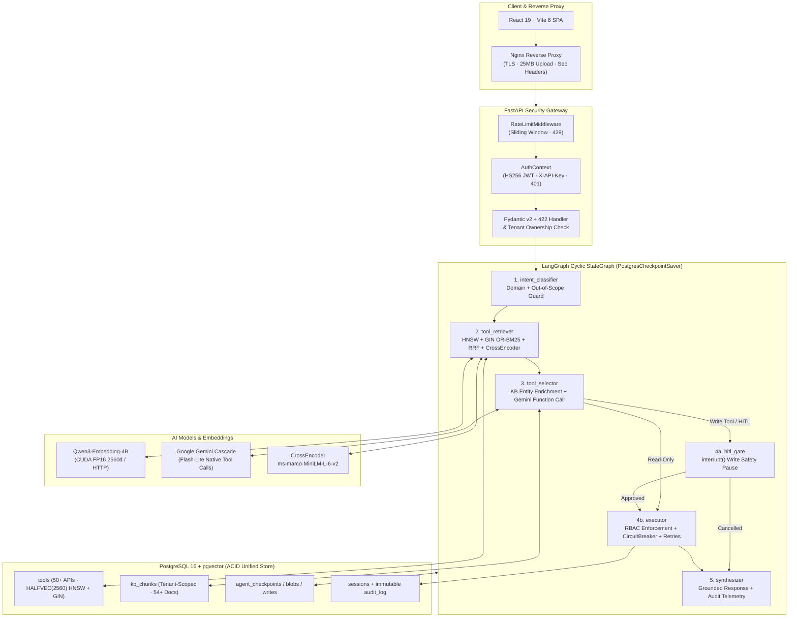

---

## User Interface Walkthrough (All Pages)

The frontend (`frontend/src/`) provides 7 workspace views spanning operations KPIs, conversational execution, HITL approval governance, tool catalog/RAG testing, document RAG, distributed tracing, and RBAC settings, with instant Light/Dark theme switching.

### 1. Operations Home Dashboard (`HomeDashboard.jsx`)
Displays indexed tool counts, benchmarked Recall@5 and P95 retrieval latency, domain distribution across `Disputes`, `Payments`, `Invoicing`, `Procurement`, and `Analytics`, and quick links to start live workflows.

| Light Mode (`01_home_dashboard.png`) | Dark Mode with Live Session Activity (`10_dark_mode_dashboard.png`) |
| :---: | :---: |
| 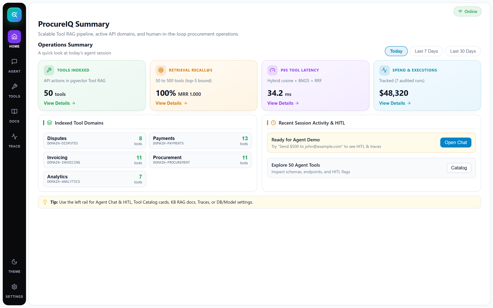 | 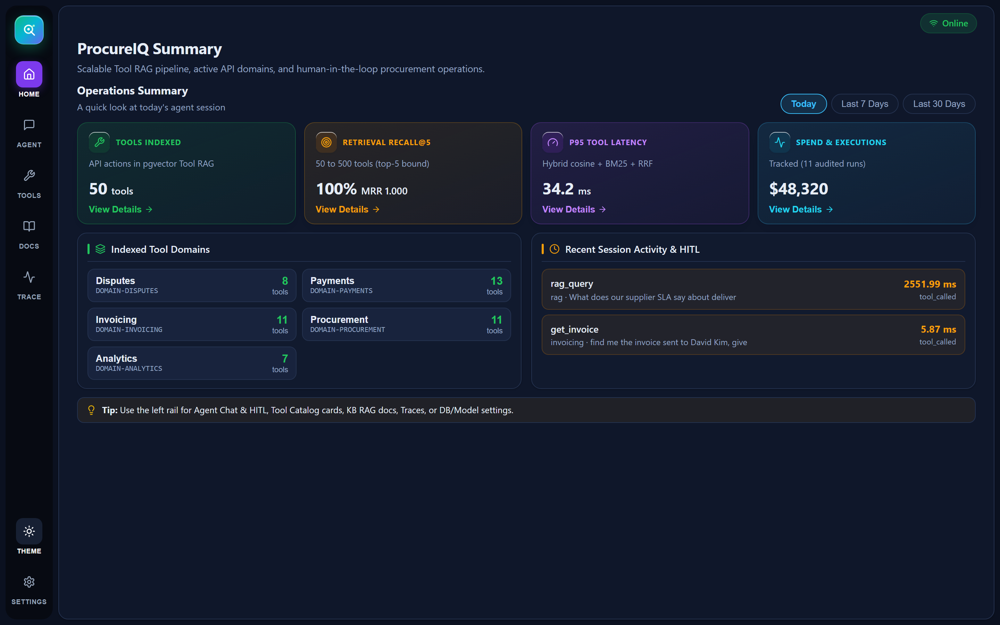 |

---

### 2. Agent Chat — Dynamic Tool RAG & KB Entity Grounding (`ChatPanel.jsx`)
Demonstrates an end-to-end read lookup (`"find me the invoice sent to David Kim, give me all the details"`): `ToolRetriever` scores all 50 active tools in **78.51 ms**, binds only the top-5 (`get_invoice` #1 at `0.5547`), enriches `INVOICE_005` (`$1,420.00`, `david.kim@quantledger.ai`) from the knowledge base, and exposes full candidate scores and node timings inline.

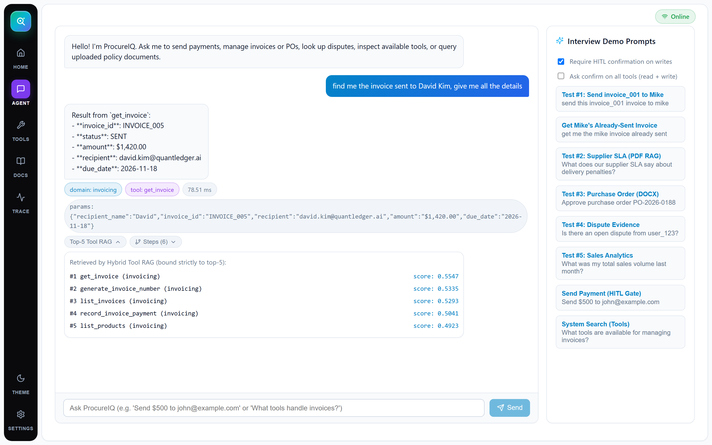

---

### 3. Agent Chat — Durable HITL Gate & Pipeline Trace (`ChatPanel.jsx`)
Demonstrates high-risk write governance (`"Approve purchase order PO-2026-0301"`): the agent resolves vendor details (`Aegis Cyber Assurance LLC`, `$32,000.00`) from `PO-2026-0301_Security_Audit.docx`, pauses unconditionally at `hitl_gate` via LangGraph `interrupt()`, persists the state to PostgreSQL (`agent_checkpoints`), and presents editable parameters alongside `Approve & Execute` / `Cancel` controls.

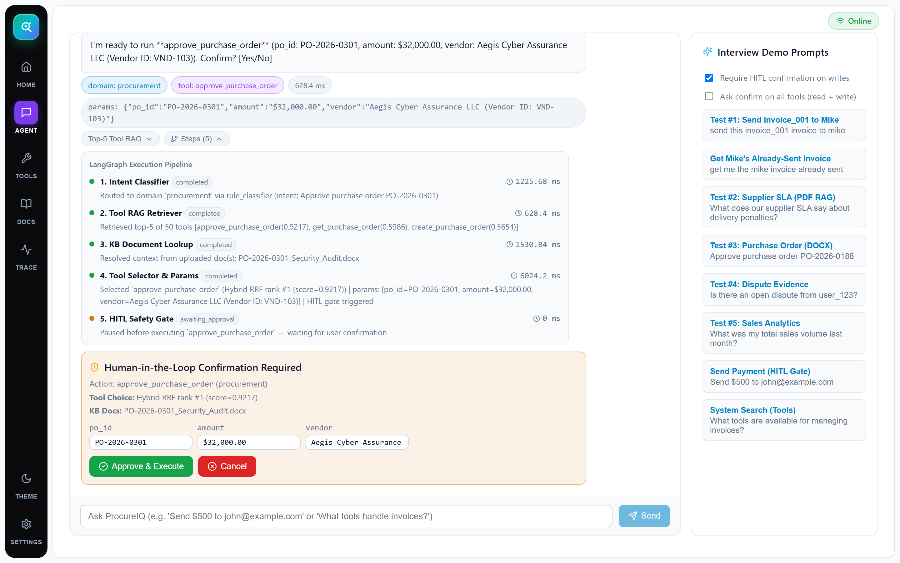

---

### 4. Interactive Tool Catalog & Schema Inspector (`ToolCatalog.jsx`)
Searchable registry covering all **50 PayPal/FinTech adapter operations** plus **2 built-in meta-tools** (`rag_query`, `system_search`). Filterable by domain and safety tier (`Read-Only` vs. `HITL Write`), with a click-to-inspect modal displaying the adapter endpoint, extracted parameter schema, and one-click chat prompt launcher.

| Tool Catalog Grid (`04_tool_catalog.png`) | Tool Details Inspector Modal (`05_tool_inspector_modal.png`) |
| :---: | :---: |
| 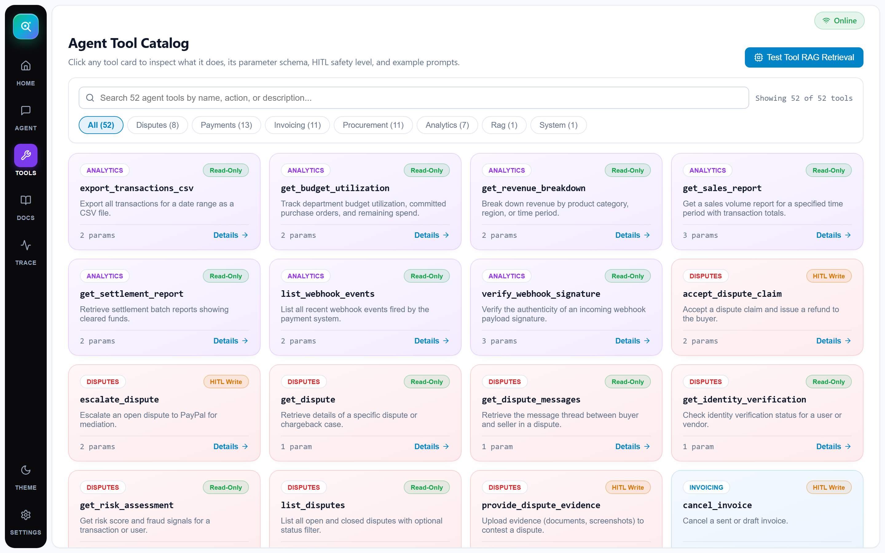 | 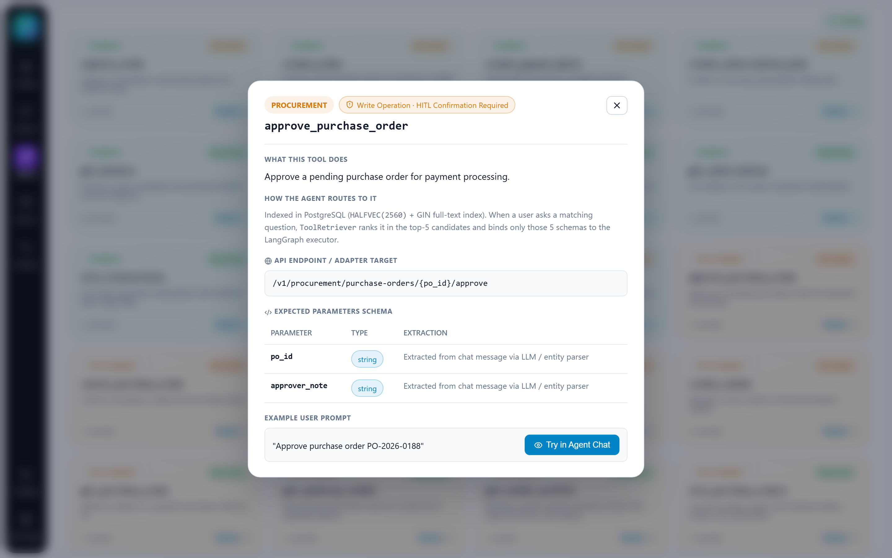 |

---

### 5. Semantic Tool RAG Explorer (`ToolExplorer.jsx`)
Interactive architecture proof bench wired directly to `POST /api/tools/retrieve`. Shows live `Qwen/Qwen3-Embedding-4B (local-cuda)` query embedding, `pgvector` HNSW cosine similarity, GIN OR-BM25 lexical scores, `ms-marco-MiniLM-L-6-v2` cross-encoder scores, and composite final rankings across adjustable `Top-K` cutoffs.

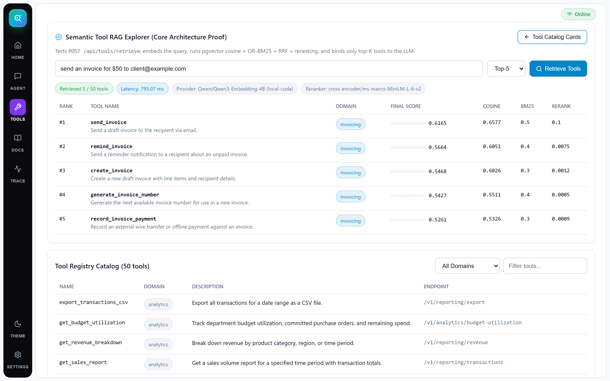

---

### 6. Knowledge Base & Hybrid RAG Tester (`KnowledgeBasePanel.jsx`)
Supports `.txt`, `.md`, `.pdf`, `.docx`, `.csv`, `.json`, and `.log` uploads (up to 25 MB, sentence-boundary chunked into `kb_chunks`), lists **54 pre-indexed multi-format enterprise documents** per tenant, and includes a live Hybrid RAG Q&A runner with RRF-scored citations and excerpts.

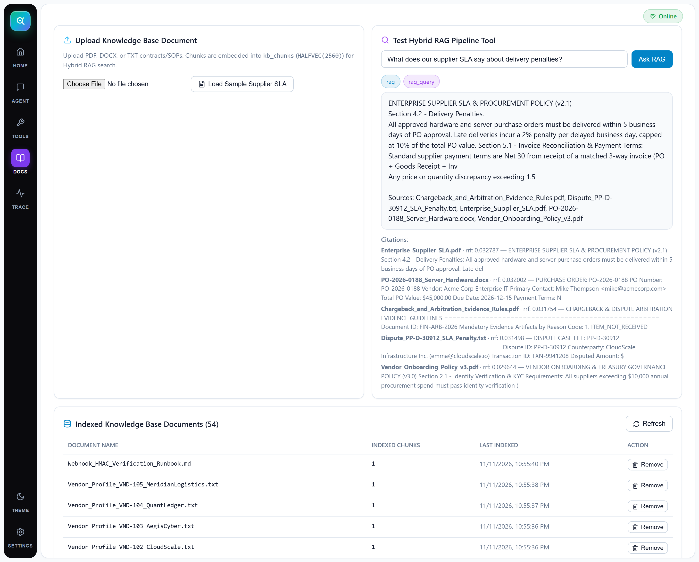

---

### 7. Trace & Observability Dashboard (`ObservabilityPanel.jsx`)
Exposes real-time active vector/chunk counts, audited execution telemetry, verified `50 -> 500` tool scaling benchmarks, per-adapter `CircuitBreaker` health (`CLOSED` / `OPEN` / `HALF_OPEN`), and the per-session execution timeline showing candidate scores and latency per LangGraph node.

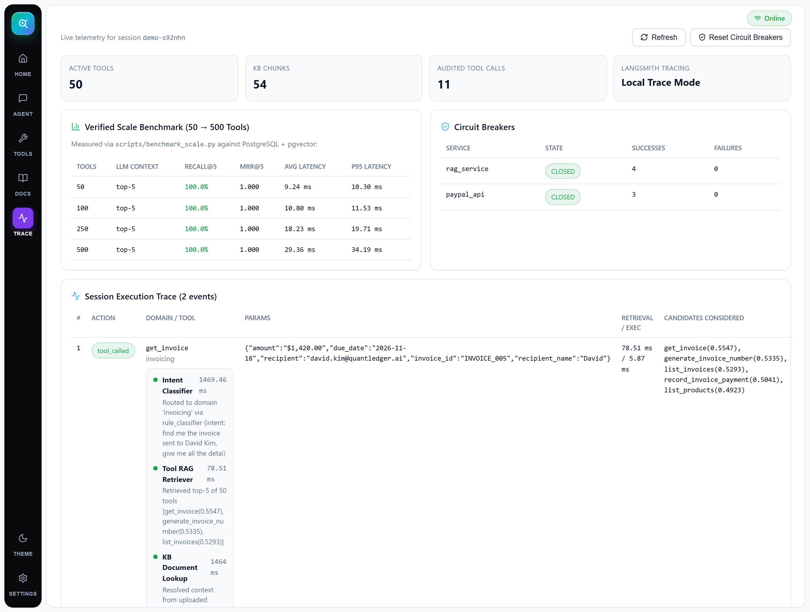

---

### 8. Settings, Multi-Tenancy & RBAC Governance (`SettingsPanel.jsx`)
Manages workspace isolation (`X-Tenant-ID`), 4-tier RBAC roles (`viewer`, `operator`, `finance_vp`, `admin`), stateless **HS256 JWT** issuance for API authentication, active embedding provider diagnostics (`2560d HALFVEC`), durable checkpointer status, and manual circuit breaker resets.

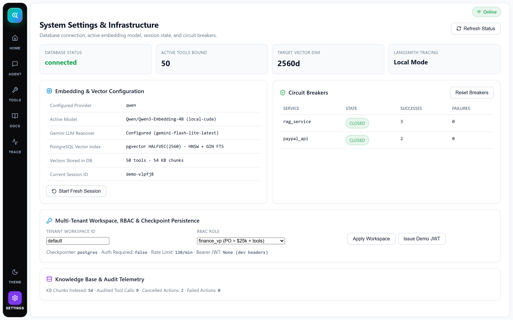

---

## Hybrid Retrieval & Ranking Algorithms

Implemented consistently across both **`ToolRetriever`** (`backend/app/tools/retriever.py`) and **`HybridSearchService`** (`backend/app/core/hybrid_search.py`):

1. **Query Normalization & OR-BM25 (`build_or_tsquery`):** Fixes common typos (e.g., `invoive -> invoice`, `purcahse -> purchase`), strips conversational stopwords, and joins tokens with PostgreSQL `|` (`OR`) instead of `AND` so filler words in natural queries never drop sparse matches over GIN `to_tsvector` indexes.
2. **Dense Cosine over `HALFVEC(2560)`:** Open-source `pgvector` caps standard `vector` HNSW indexes at 2,000 dimensions, whereas `Qwen/Qwen3-Embedding-4B` outputs 2,560d representations. Storing vectors as FP16 **`halfvec(2560)`** (`halfvec_cosine_ops` HNSW) preserves full 2,560d precision while halving vector index memory footprint. Any alternative provider (`384d`, `768d`, `1536d`, `3072d`) is cleanly mapped via `align_embedding_dimension`.
3. **Reciprocal Rank Fusion (RRF, $k=60$):**
   $$\text{RRF}(d) = \frac{1}{60 + \text{rank}_{\text{dense}}(d)} + \frac{1}{60 + \text{rank}_{\text{bm25}}(d)}$$
4. **Composite Final Tool Score & Intent Safety Multiplier (`M_intent`):**
   $$S_{\text{final}}(t) = \Big[0.45 \cdot \frac{\text{RRF}(t)}{\text{RRF}_{\max}} + 0.35 \cdot \sigma(\text{CrossEncoder}(q, t)) + 0.20 \cdot \cos(q, t)\Big] \times M_{\text{intent}}(q, t)$$
   - $M_{\text{intent}} = 0.55$ when a destructive verb (`cancel`, `void`, `delete`) is scored against a non-destructive query.
   - $M_{\text{intent}} = 0.65$ when a mutating write (`send`, `remind`, `create`) matches pure lookup intent (`"get me"`, `"already sent"`).
   - $M_{\text{intent}} = 1.00$ otherwise.
5. **Two-Pass Knowledge Base Reranking (`rag_query`):** Retrieves top-$2k$ chunks via RRF (`HybridSearchService`), runs a second-pass Gemini relevance scoring pass (`0–10`), and returns grounded citations (`filename`, `rrf_score`, `llm_score`, `excerpt`).
6. **Three-Layer Scope & Validation Guard:** Off-topic prompts (weather, trivia) and greetings are intercepted across classifier rules, Gemini intent supervision, and semantic score floors, responding politely without triggering financial tools (`tool_used=null`).

---

## Verified Scaling Benchmark (50 to 500 Tools)

Measured via [`scripts/benchmark_scale.py`](scripts/benchmark_scale.py) and recorded in [`docs/scale_benchmark_report.json`](docs/scale_benchmark_report.json) against PostgreSQL + `pgvector` (`top_k=5` bound to the LLM at every scale tier):

| Active Tools in Registry | Tools Bound to LLM | Recall@5 | MRR@5 | Avg Latency | P95 Latency |
|---:|---:|---:|---:|---:|---:|
| **50** | top-5 (`O(k)`) | **100.0%** | `1.000` | `9.24 ms` | `10.30 ms` |
| **100** | top-5 (`O(k)`) | **100.0%** | `1.000` | `10.80 ms` | `11.53 ms` |
| **250** | top-5 (`O(k)`) | **100.0%** | `1.000` | `18.23 ms` | `19.71 ms` |
| **500** | top-5 (`O(k)`) | **100.0%** | `1.000` | `29.36 ms` | `34.19 ms` |

> An automated 500-tool scale assertion (`test_500_tool_scale_keeps_constant_topk_and_high_recall` in `backend/tests/test_phase3_resilience_and_scale.py`) also enforces `Recall@5 >= 87.5%` and mean retrieval latency `< 200 ms` on synthetic perturbations in CI.

---

## Security, RBAC Governance & Durable State

| Control Layer | Implementation | Enforcement Details |
|---|---|---|
| **Authentication** | `backend/app/core/security.py` | Timing-safe HMAC-SHA256 JWT (`create_access_token`, `decode_access_token`) + optional `API_KEYS_CSV`. Automatically required when `ENVIRONMENT=production` (`AUTH_ENABLED=true`). Returns `401` on invalid/missing credentials. |
| **4-Tier RBAC** | `viewer`, `operator`, `finance_vp`, `admin` | Enforces policy gates such as `approve_purchase_order > $25,000` requiring `finance_vp` or `admin` (`Vendor_Onboarding_Policy_v3.pdf`). Denials return `403` and log `rbac_denied` to `audit_log` while preserving paused HITL checkpoints for VP escalation. |
| **Multi-Tenant Isolation** | `tenant_id` across `kb_chunks`, `sessions`, `audit_log` | SQL retrieval predicates filter KB vectors and BM25 queries strictly by authenticated `tenant_id`. Session reads/confirms reject cross-tenant access with `403`. |
| **Durable Checkpointing** | `PostgresCheckpointSaver` (`asyncpg`) | Custom LangGraph `BaseCheckpointSaver` persisting graph snapshots, blobs, and pending writes in `agent_checkpoints`, `agent_checkpoint_blobs`, and `agent_checkpoint_writes` via `ON CONFLICT` upserts. Survives server restarts seamlessly. |
| **Resilience** | `CircuitBreaker` (`backend/app/core/resilience.py`) | Wraps downstream adapters (`paypal_api`, `rag_service`, `system_search`). Trips `OPEN` after `3` failures (`CircuitOpenError`), transitions to `HALF_OPEN` after `30s` cooldown for single canary probing, plus exponential backoff retries. |
| **Rate Limiting & Input Hygiene** | `RateLimitMiddleware` + Pydantic v2 | Sliding-window `120 req/min` per IP (`429 Retry-After: 60`), strict upload extension/size caps (`25 MB`), regex-validated IDs, and readable `422` validation summaries. |

---

## REST API Reference

Interactive Swagger documentation is available at `http://localhost:8000/docs`.

| Method | Endpoint | Purpose |
|---|---|---|
| `GET` | `/health` | DB connection state, active tools count, loaded embedding model & target dim, checkpointer & auth flags |
| `POST` | `/api/auth/token` | Issue an HS256 Bearer JWT (`user_id`, `tenant_id`, `role`) |
| `GET` | `/api/auth/me` | Return current resolved `AuthContext` |
| `POST` | `/api/chat` | Execute a conversational turn through the LangGraph agent pipeline |
| `POST` | `/api/chat/confirm` | Resume a paused HITL checkpoint (`approved: true/false`, optional param edits & VP escalation) |
| `GET` | `/api/sessions/{session_id}` | Inspect persisted checkpoint state & pending HITL action |
| `GET` | `/api/sessions/{session_id}/history` | Retrieve tenant-scoped conversation history from `audit_log` |
| `GET` | `/api/sessions/{session_id}/trace` | Full forensic trace: Tool RAG candidates, Cosine/BM25/RRF/Rerank scores, and node timings |
| `GET` | `/api/tools` | List active tools & domain counts (`?domain=&q=`) |
| `GET` | `/api/tools/{name}` | Inspect individual tool metadata and JSON schema |
| `POST` | `/api/tools/retrieve` | Test semantic + BM25 + RRF Tool RAG retrieval (`top_k`, score breakdown, latency) |
| `POST` | `/api/tools` | Dynamically register a new tool with instant embedding generation (`201`) |
| `DELETE` | `/api/tools/{name}` | Deactivate/remove a tool from the registry |
| `POST` | `/api/kb/upload` | Ingest `.txt`, `.md`, `.pdf`, `.docx`, `.csv`, `.json`, or `.log` into `kb_chunks` (`201`) |
| `GET` | `/api/kb/documents` | List indexed Knowledge Base documents & chunk counts for the active tenant |
| `DELETE` | `/api/kb/documents/{document_name}` | Delete all chunks for a document within the active tenant |
| `GET` | `/api/system/observability` | Global vector counts, tool/domain distribution, circuit breaker states, audit counts, LangSmith status |
| `POST` | `/api/system/circuit-breakers/reset` | Manually reset all downstream circuit breakers to `CLOSED` |

---

## Project Structure

```text
procureiq-agent/
├── backend/
│   ├── alembic/
│   │   └── versions/
│   │       ├── 001_initial_schema.py              # Base pgvector tools, kb_chunks, sessions, audit_log
│   │       └── 002_production_hardening.py        # HALFVEC(2560) HNSW, GIN FTS, tenant_id, checkpoints
│   ├── app/
│   │   ├── agents/
│   │   │   ├── graph.py                           # LangGraph StateGraph & hitl_gate_node interrupt()
│   │   │   ├── postgres_checkpointer.py           # Asyncpg PostgresCheckpointSaver (BaseCheckpointSaver)
│   │   │   ├── state.py                           # Typed AgentState + step reducer Telemetry
│   │   │   └── nodes/
│   │   │       ├── intent_classifier.py           # Domain router & Out-of-Scope guard
│   │   │       ├── tool_retriever.py              # Tool RAG LangGraph node
│   │   │       ├── executor.py                    # KB enrichment, Gemini selection, RBAC & execution
│   │   │       └── synthesizer.py                 # Grounded response formatting & guidance
│   │   ├── api/                                   # auth_api.py, chat.py, tools_api.py, observability.py
│   │   ├── core/
│   │   │   ├── embedding/                         # Factory + Qwen3-4B CUDA/HTTP, Gemini, OpenAI, BGE, Hash
│   │   │   ├── hybrid_search.py                   # Shared HALFVEC HNSW + OR-BM25 + RRF engine
│   │   │   ├── llm_client.py                      # Gemini Flash-Lite cascade & deterministic fallbacks
│   │   │   ├── reranking.py                       # CrossEncoder + compute_intent_multiplier safety logic
│   │   │   ├── resilience.py                      # Per-adapter CircuitBreaker FSM & retry backoff
│   │   │   └── security.py                        # HS256 JWT, API Keys, 4-tier RBAC, RateLimitMiddleware
│   │   ├── infrastructure/database/               # SQLAlchemy 2.0 async engine, ORM models, init_db.sql
│   │   ├── tools/                                 # retriever.py, registry.py, paypal_adapter.py, rag_tool.py
│   │   ├── config.py                              # Pydantic Settings (env-driven)
│   │   └── main.py                                # FastAPI entrypoint, CORS, 422 handler, /health
│   ├── tests/                                     # Phases 1–5 integration, scale, auth, RBAC & restart tests
│   ├── Dockerfile & entrypoint.sh                 # Production container with Alembic migrations on boot
│   └── requirements.txt
├── frontend/
│   ├── src/
│   │   ├── components/
│   │   │   ├── ChatInterface/ChatPanel.jsx
│   │   │   ├── Home/HomeDashboard.jsx
│   │   │   ├── KnowledgeBase/KnowledgeBasePanel.jsx
│   │   │   ├── Observability/ObservabilityPanel.jsx
│   │   │   ├── Settings/SettingsPanel.jsx
│   │   │   └── ToolExplorer/                      # ToolCatalog.jsx & ToolExplorer.jsx
│   │   ├── api.js
│   │   ├── App.jsx
│   │   └── index.css
│   ├── Dockerfile & nginx.conf                    # Multi-stage Nginx SPA bundle + /api reverse proxy
│   └── package.json
├── sample_docs/                                   # 54 multi-format enterprise FinTech/procurement docs
├── scripts/
│   ├── seed_tools.py                              # Seeds 50 FinTech/procurement tools + embeddings
│   ├── generate_enterprise_docs.py                # Generates 54 TXT/MD/PDF/DOCX test documents
│   ├── upload_sample_docs.py                      # Batch-indexes sample_docs/ via API
│   ├── benchmark_scale.py                         # 50 -> 500 tool recall & latency benchmark
│   └── generate_solution_pdf.py                   # Generates ProcureIQ Solution Architecture PDF
├── docs/
│   ├── screenshots/                               # UI screenshots embedded above
│   ├── DEMO_SCRIPT.txt & SETUP.txt
│   └── scale_benchmark_report.json
├── docker-compose.yml                             # Full stack: pgvector DB + FastAPI backend + Nginx UI
├── start_dev.bat                                  # One-click Windows local dev launcher
└── ProcureIQ_Solution_Architecture_Engineering.pdf
```

---

## Quickstart & Deployment

### Option A: Local Development Setup

```bash
# 1. Configure environment variables
cp .env.example .env
# Edit .env to set GEMINI_API_KEY (and optional LANGCHAIN_API_KEY)

# 2. Start PostgreSQL 16 + pgvector container
docker-compose up db -d

# 3. Install backend dependencies, run migrations & seed tools
cd backend
pip install -r requirements.txt
python -m alembic upgrade head
python ../scripts/seed_tools.py

# 4. Generate & upload the 54 enterprise knowledge base documents
python ../scripts/generate_enterprise_docs.py
python ../scripts/upload_sample_docs.py

# 5. Start backend API (port 8000) and React frontend (port 5175)
python -m uvicorn app.main:app --host 0.0.0.0 --port 8000 --reload
cd ../frontend && npm install && npm run dev -- --port 5175
```

Or on Windows after DB initialization, run `start_dev.bat`.

- **Web Application:** `http://localhost:5175`
- **Interactive API Docs (Swagger):** `http://localhost:8000/docs`
- **Health Endpoint:** `http://localhost:8000/health`

---

### Option B: Full-Stack Docker Compose (Production Mode)

In production (`docker-compose.yml`), `ENVIRONMENT=production` automatically enables cryptographic auth (`AUTH_ENABLED=true`) and routes embedding requests via `QWEN_USE_HTTP_FIRST=true` to a shared inference server (`QWEN_BASE_URL`) so stateless backend workers do not duplicate GPU VRAM:

```bash
# Start PostgreSQL + Backend (Nginx/Uvicorn) + Frontend (port 8088)
docker-compose up -d --build
```

- **Production UI (Nginx):** `http://localhost:8088`

---

## Testing & Verification

The automated test suite under `backend/tests/` validates all five architectural phases (**31/31 passing** with `Qwen3-Embedding-4B`):

```bash
cd backend
python -m pytest tests/ -v
```

> **Single-GPU note:** Stop the running Uvicorn dev server before running `pytest` locally with `EMBEDDING_PROVIDER=qwen` so two Python processes do not attempt to load `Qwen3-Embedding-4B` into GPU VRAM concurrently.

| Test Suite | Coverage |
|---|---|
| `test_phase1_tool_rag.py` | Hybrid Tool RAG ranking, OR-BM25 normalization, `rag_query`, `system_search`, dynamic registration |
| `test_phase2_agent_core.py` | LangGraph routing, `hitl_gate` `interrupt()` pause & `Command(resume=...)`, `/api/chat` + `/api/chat/confirm` |
| `test_phase3_resilience_and_scale.py` | `CircuitBreaker` state transitions (`CLOSED -> OPEN -> HALF_OPEN`), retries, `500`-tool scale (`Recall@5 >= 87.5%`, `<200ms`) |
| `test_phase4_gemini_and_steps.py` | Gemini function calling integration, KB entity enrichment/disambiguation, per-node execution trace steps |
| `test_phase5_production_hardening.py` | Durable checkpoint restart survival, 4-tier RBAC (`$25k` VP gate `403`), tenant isolation, HS256 JWT `401`, rate limit `429`, out-of-scope guard & Pydantic `422` |
